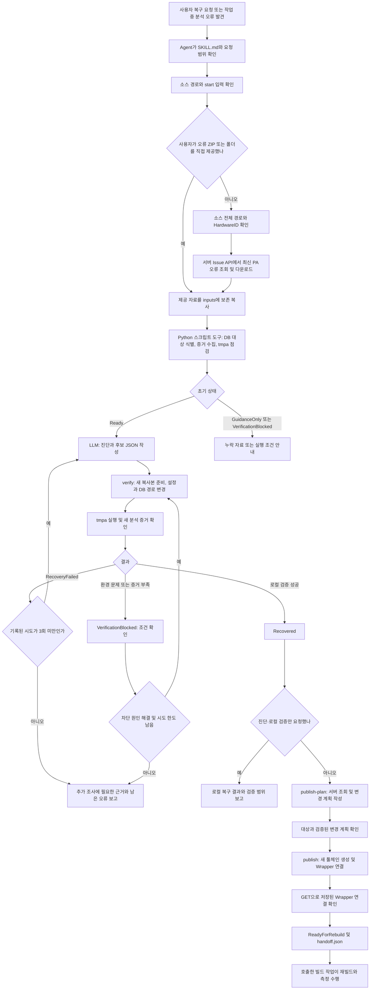

# COVER 툴체인 복구 플러그인 동작 구조

## 핵심 구조

COVER C/C++ 분석 오류의 원인과 설정 변경안을 **LLM이 판단하는 스킬**이다. 예를 들어 분석기가 실제 컴파일러보다 오래된 문법 설정을 쓰면, LLM이 로그·컴파일 명령·버전·설정을 대조해 변경안을 만들고 Python 도구가 복사본에 적용해 `tmpa`로 검증한다.

### 세 역할의 연결

| 구성 | 하는 일 | 주고받는 결과 |
| --- | --- | --- |
| LLM / 호출하는 AI 에이전트 | `SKILL.md`에 따라 증거를 진단하고 최소 변경안 작성. 검증 성공 후 서버 반영까지 진행. | `diagnosis.md`, 후보 JSON, 도구 호출 |
| Python 스크립트 도구 | 자료·DB 처리, 원본 보존, 후보 적용, PA 실행·판정, 검증된 서버 반영. | JSON, `case.json`, `report.md`, 검증 산출물 |
| COVER PA: tmpa | C/C++ 파싱과 커버리지용 계측 소스 생성. | 콘솔·오류 로그, DB 상태, 계측 소스 |

이 폴더에는 LLM 호출 코드나 모델 API 키가 없다. 외부 AI 에이전트가 문서를 읽고 판단한 뒤 `${SKILL_ROOT}/scripts/cover_recovery.py`를 호출한다. 도구는 오류 문구를 고정된 해법에 대입하지 않으며, 진단부터 재빌드까지 자동 반복하지 않는다.

## 전체 동작 흐름



자료 확보는 `start`로 한다. 서버 조건이 부족해 `NeedsInput`이면 누락 조건을 보충해 재개한다. `tmpa`를 쓸 수 없으면 `GuidanceOnly`로 진단·안내까지만 수행한다. `VerificationBlocked`를 포함한 검증 시도는 case마다 최대 3회다.

## 1. 진입과 오류 자료 확보

실행 위치는 COVER Agent가 설치된 빌드 PC다. Python 3.11 이상과 표준 라이브러리, SQLite DB를 메모리에서 읽는 `sqlite3.deserialize`가 필요하다.

빌드 콘솔에 `(analysis error)`가 있으면 첫 작업은 `start`다. 먼저 빌드 작업 폴더와 소스명을 합쳐 원래 소스의 전체 경로를 확보한다. 자료를 모으기 위해 Wrapper나 빌드를 먼저 재실행하지 않는다.

### 사용자가 오류 ZIP·폴더를 직접 제공한 경우

`start --artifacts ...`로 시작한다. 제공 자료를 새 실행 폴더의 `inputs/`에 보존 복사하며 서버 연결 없이 진행할 수 있다.

### 오류 자료를 직접 제공하지 않은 경우

1. `discovery.py`가 빌드 폴더, Agent·서버 설정, 로컬 자료 위치를 탐색한다.
2. 빌드 계정의 `.cstm_HardwareAddress` 끝에서 오류를 만든 Agent의 HardwareID를 읽는다.
3. `GET /cover-open-api/v1/issue/download`에 MAC 주소·소스 전체 경로·`PA_ERROR_RESULT`를 전달한다.
4. 서버가 선택한 최신 오류 ZIP을 다운로드하고 `inputs/`를 준비한다. 경로 검색은 구분자·대소문자를 무시한 끝부분 일치다.
5. ZIP 내부 DB의 소스 경로를 확인한다. 응답에 없는 Issue ID·발생 시각은 기록하지 않는다.

로컬 ZIP은 생성 Agent를 증명하지 못하므로 자동 수집 경로에서 서버 확인을 대신하지 않는다.

메인 API와 Agent의 remote-service 주소를 구분한다. `CODESCROLL_TM_SERVER_URL`과 `fixedServerUrl`을 메인 API 주소로 자동 사용하지 않는다. 서버 수집은 HTTPS와 `COVER_ACCESS_KEY`를 사용한다.

Open API의 HTTPS 인증서 검증은 기본으로 생략한다. 자체 서명·만료·hostname 불일치가 있어도 별도 옵션 요청 없이 수집·조회·서버 반영을 진행한다. 인증서 검증을 직접 요청한 경우에만 `--verify-tls`를 사용한다.

COVER에서 발급받은 키만 환경변수에 넣는다. `Bearer `는 클라이언트가 붙인다.

```powershell
$env:COVER_ACCESS_KEY = '<발급받은 Access key>'
python "${SKILL_ROOT}/scripts/cover_recovery.py" collect --server https://cover.example.com --hardware-id AA-BB-CC-DD-EE-FF --source C:/src/main.cpp --archive ./issue.zip --run-dir ./recovery
```

다른 환경변수 이름은 `--access-key-env MY_COVER_KEY`로 지정한다. `--server`는 서버 루트, `/cover-open-api`, `/cover-open-api/v1` 주소를 받는다. `--username-env`, `--password-env`는 지원하지 않는다. 자세한 계약은 [서버 Open API 계약](references/server-api.md)을 읽는다.

서버 반영에는 복사본 PA 검증을 통과한 배포용 설정을 쓴다. 기존 설정 본문은 다시 읽지 않는다. Open API로 기존 툴체인과 Wrapper 연결을 확인하고, 검증된 설정으로 새 툴체인을 만든 뒤 지정 Wrapper에 연결한다.


## 2. 진단과 후보 작성

Python 스크립트 도구는 `project.db`, `global.db`, `pa.ini`, 컴파일러 `.conf`, `.elog`를 확인한다. DB에서 다음 연결을 따라 실제 설정을 찾는다.

```text
원래 소스 경로
  → project.db의 SourceFile
  → TranslationUnit: 한 번에 분석하는 소스 단위, TU
  → idCompiler
  → global.db의 Compiler.confFile
  → 해당 컴파일러의 .conf
```

검증 범위는 오류 소스 하나가 아니라 선택한 case에서 같은 컴파일러에 연결된 TU 전체다. 비활성·제외 TU가 있거나 다른 case에도 같은 컴파일러가 있어 전체 검증이 불가능하면 중단한다.

결과와 반영 계획에서는 검증한 TU와 공유 Toolchain·Wrapper의 영향 범위를 구분한다. 한 case의 성공을 다른 프로젝트나 재빌드의 성공으로 확대하지 않는다.

LLM은 최초·연쇄 오류를 구분하고 컴파일 명령·버전·전처리 소스·활성 설정을 대조한다. 사실, 가설, 변경 후보 또는 후보를 만들지 않은 이유는 `diagnosis.md`에 쓴다.

### LLM과 Python 스크립트 도구 사이의 후보 JSON

아래는 형식 예시다. GCC 12.3.0과 기존 설정의 불일치를 확인한 경우에만 이 변경을 제안할 수 있다.

```json
{
  "reason": "실제 GCC 12.3.0과 분석 설정의 버전 값이 다름을 확인",
  "evidence": [
    "compiler-version.txt:1: GCC 12.3.0 출력",
    "active.conf:3: gnu_version=100300"
  ],
  "replacements": [
    {
      "old": "gnu_version=100300",
      "new": "gnu_version=120300"
    }
  ],
  "append_lines": []
}
```

`reason`과 `evidence`는 필수다. `old`는 기존 설정에서 정확히 한 번 일치하는 한 줄이어야 한다. 인코딩·개행을 보존하고 설정 전체를 다시 쓰지 않는다.

Python 도구는 후보 형식과 적용 조건을 검사한다. 근거의 사실 여부와 원인 판단은 LLM의 책임이다. 분석 의미를 없애거나 느슨하게 만들 수 있는 `cs_ignore_*`, `cs_replace_code*`, `cs_disable_keyword`, `cs_allow_*`는 자동 검증에서 제외한다.

## 3. 복사본 검증

`verify`는 후보마다 새 `attempts/<번호>/workspace`를 만든다. 매번 원본 입력에서 시작하므로 이전 후보의 변경을 이어가려면 새 후보 JSON에도 넣는다.

1. 원본과 `inputs/`의 파일 목록·SHA-256을 대조한다. SHA-256은 파일이 바뀌었는지 확인하는 지문 값이다.
2. 후보를 적용하고 배포용 `proposed.conf`를 별도로 보관한다.
3. 검증용 복사본의 `Compiler.confFile`과 DB·INI·설정의 필요한 경로를 새 workspace 내부로 바꾼다.
4. 분석 상태를 초기화하고, 대상 TU·설정·파일 해시·경로 점검 결과를 `verification.json`에 기록한다.
5. `tmpa`를 실행하고 실행 전후의 로그·DB·계측 소스를 대조한다.
6. 결과를 `case.json`과 `report.md`에 저장하고 원본이 유지됐는지 다시 확인한다.

실행 형태는 다음과 같다. `win|linux`는 실행 PC의 OS이며, 컴파일 대상인 설정의 `target`과 별개다.

```text
tmpa <workspace/project.db> <workspace/global.db> win|linux <workspace/pa.ini>
```

기본 제한은 회당 600초, `--timeout`은 1~600초다. 후보 수가 아니라 case의 시도 횟수로 최대 3회다. `VerificationBlocked`도 한도를 소비한다. 같은 변경은 반복하지 않으며, 차단된 후보는 조건을 해결한 뒤 남은 시도 안에서 재검증한다. 조건이 같으면 반복하지 않고, 한도 우회용 새 case도 만들지 않는다.

### Recovered의 조건

`Recovered`는 `make` 성공이나 `.elog` 부재만으로 판정하지 않는다. 다음을 모두 확인해야 한다.

- 새 분석 실행에서 대상 TU(Translation Unit)의 파싱 성공이 확인된다.
- 분석 결과에 해당 대상의 관련 오류가 없다.
- 해당 TU에 대한 새 계측 결과가 생성된다.

하나라도 확인되지 않으면 `GuidanceOnly` 또는 검증 차단 상태로 남긴다.

## 4. 실제 설정 반영

로컬 검증 성공은 `Recovered`다. `verify`는 서버나 Agent를 바꾸지 않는다. 서버 반영이 요청 범위에 포함된 경우 다음 두 명령으로 진행한다.

### publish-plan: 변경할 내용을 고정

서버를 조회해 HardwareID, Agent DB ID, 실제 C/C++ Wrapper와 기존 툴체인을 확인한다. Wrapper는 빌드 명령과 COVER 분석 설정을 잇는 등록 항목이다.

현재 Wrapper 연결과 기존 툴체인의 식별·표시 정보를 확인하고, 검증을 통과한 배포용 설정으로 새 툴체인 계획을 만든다. 로컬 workspace 경로가 들어간 검증용 설정은 서버에 보내지 않는다.

`publish-plan.json`에는 대상 서버·Wrapper, 기존 툴체인과 Agent 스냅샷, 새 설정·이름·버전, 검증 파일 해시를 저장한다. `plan_digest`는 계획의 지문이다. `rollback.json`도 준비하지만 서버는 바꾸지 않는다.

### publish: 검증된 계획 실행

복구 요청이나 빌드 중 분석 오류 복구는 PA 검증 성공 후 서버·Wrapper 반영까지 추가 승인 없이 진행한다. 진단·로컬 검증만 명시한 요청은 해당 범위에서 종료한다.

`publish`는 생성한 계획의 `--plan-digest`로 실행한다. 대상 서버와 검증 결과가 일치해야 하며 별도 승인 옵션은 없다. 실제 실행 계획과 시각은 `publication_execution`에 기록한다.

실행 순서:

1. 계획의 digest, 검증 파일 해시, 서버 주소가 일치하는지 확인한다.
2. Agent 설정·Wrapper 연결과 기존 툴체인의 식별·표시 정보를 다시 조회해 계획 이후 변경됐는지 확인한다.
3. 기존 툴체인을 보존하고 새 툴체인을 생성한다.
4. 지정 Wrapper의 `toolChainInfoId`를 새 항목으로 바꾼 `toolChains` 목록을 PATCH한다. 표시 이름은 서버가 참조에서 반환한다.
5. 서버를 다시 조회해 새 Wrapper 연결이 저장됐는지 확인한다.
6. 확인이 끝나면 `ReadyForRebuild`와 `handoff.json`을 기록한다.

Agent 구성 Open API는 `toolChains` 전체를 교체한다. 최신 목록에서 지정 Wrapper의 참조 ID만 바꾸고 나머지 필드는 보존한다. Agent 상태·사용자·경로·정책은 보내지 않는다. 원자적 조건부 갱신 계약이 없어 마지막 조회와 변경 사이의 동시 편집은 막지 못한다.

## 5. 결과 전달과 재빌드 인계

`Recovered`는 명시한 범위에서 복사본의 회복을 확인했다는 뜻이다. 서버 반영이 없으면 원인·변경·검증 범위·남은 작업을 보고하고, 반영 후에는 호출자가 재빌드와 측정을 이어간다.

`report.md`는 스크립트가 기록한 관측 결과이고, `diagnosis.md`와 사용자 설명은 Agent가 작성한다.

### 상태를 읽는 법

CLI 상태 이름을 그대로 기록하고 막힌 단계와 다음 조치를 설명한다. 입력 부족·환경 문제·분석 실패를 모두 “복구 실패”로 묶지 않는다.

| 상태 | 의미 | 다음 처리 |
| --- | --- | --- |
| NeedsInput | 서버 수집에 필요한 주소·HardwareID·Access key 환경변수 등의 조건 부족. | 누락 조건만 확보한 뒤 start 재호출. |
| Ready | 자료와 런타임의 초기 점검 완료. | LLM이 원인을 판단하고 후보 작성. |
| GuidanceOnly | 동봉 PA가 없거나 사용할 수 없음. | 진단과 변경안 안내. 배포 파일 점검. |
| VerificationBlocked | 경로·DB·환경·라이선스·시간 초과·검증 증거 부족 등으로 판정 불가. | 차단 원인 해결 후 재검증 여부 판단. |
| RecoveryFailed | PA 실행에서 분석 오류가 남아 있음. | 새 근거가 있는 다른 후보 검토. 최대 3회. |
| Recovered | 복사본의 대상 PA 검증 성공. | 복구 요청이면 서버 반영 계획으로 진행. 진단·로컬 검증만 요청했으면 결과 보고. |
| ReadyToPublish | 읽기 전용 서버 반영 계획 작성 완료. | 대상과 계획을 재검증하고 바로 반영. |
| NeedsAttention | 서버 쓰기 결과가 불명확하거나 인계 기록 실패. | 현재 서버 상태 재조회. 재빌드 인계 중단. |
| ReadyForRebuild | 서버 반영·새 Wrapper 연결 확인 완료. | 호출한 빌드 작업에 인계. |

`case.json`은 `status`와 별도로 `pa_status`, `server_status`, `handoff_status`를 보관해 서버 연결과 인계 기록의 성공 여부를 구분한다.

서버 쓰기는 중간 결과를 먼저 기록하고, 응답이 불명확하면 재전송하지 않는다. `rollback.json`은 이전 연결과 새 항목을 확인하는 기록이며 자동 되돌리기 명령은 없다. 실패 복구에 필요한 되돌리기는 현재 서버 상태와 변경 범위를 확인한 뒤 추가 승인 없이 진행한다.

`Recovered`는 PA 검증 성공, `ReadyForRebuild`는 재빌드 준비 완료다. 네이티브·계측 컴파일, 재빌드, `.cvd` 수집은 후속 작업에서 따로 확인한다.

## 파일 구성과 역할

| 파일·폴더 | 역할 |
| --- | --- |
| SKILL.md | LLM이 따라야 하는 진입 절차, 판단 기준, 작업 범위와 인계 규칙. |
| references/ | 진단·자료 탐색·PA·서버 API의 세부 계약. 필요한 단계에서 읽는 참고 문서. |
| ${SKILL_ROOT}/scripts/cover_recovery.py | CLI 명령 해석과 모듈 호출. 결과를 JSON으로 출력. |
| ${SKILL_ROOT}/scripts/cover_recovery/workflow.py | case 상태·잠금·시도 제한·보고서·검증 결과 관리. |
| ${SKILL_ROOT}/scripts/cover_recovery/discovery.py | 소스 전체 경로, 빌드 문맥, 서버·Agent 위치와 수집 조건 탐색. |
| ${SKILL_ROOT}/scripts/cover_recovery/artifact_search.py | 로컬 폴더·ZIP 안의 오류 자료 후보와 증거 파일 탐색. |
| ${SKILL_ROOT}/scripts/cover_recovery/evidence.py | SQLite DB에서 소스·컴파일러·TU 관계 확인, 로그와 설정의 관측값 수집. |
| ${SKILL_ROOT}/scripts/cover_recovery/workspace.py | 원본 보존, 안전한 ZIP 해제, 후보 적용, 복사본 DB·경로 준비. |
| ${SKILL_ROOT}/scripts/cover_recovery/pa.py | 동봉 런타임 점검, tmpa 실행, 시간 제한, 새 분석 증거와 성공·실패 판정. |
| ${SKILL_ROOT}/scripts/cover_recovery/cover_api.py | COVER Open API Access key 인증, 오류 다운로드, 툴체인·Wrapper 연결 API. |
| ${SKILL_ROOT}/scripts/cover_recovery/deployment.py | 읽기 전용 반영 계획, 대상·변경 검증, 서버 반영, 되돌리기 기록, 재빌드 인계. |
| ${SKILL_ROOT}/scripts/cover_recovery/agent.py | 빌드 계정의 파일에서 HardwareID 추출. |
| ${SKILL_ROOT}/scripts/cover_recovery/common.py | 오류 형식, JSON 입출력, 해시, 경로 등 공통 기능. |
| ${SKILL_ROOT}/assets/tmpa/ | 배포 시 OS에 맞는 PA 실행 파일과 필요한 같은 배포본 자원을 넣는 위치. |
| tests/ | 자료 탐색·DB·원본 보존·PA 판정·API·자동 반영·실패 처리에 대한 테스트. |

## 실행 기록 구조

```text
<run-dir>/
├── inputs/                       보존 입력 복사본
├── case.json                     전체 상태, 증거, 대상, 해시, 시도 이력
├── report.md                     Python 스크립트 도구가 생성·갱신하는 보고서
├── diagnosis.md                  LLM이 별도로 작성하는 진단
├── attempts/
│   └── 001/
│       ├── proposed.conf         로컬 임시 경로로 바꾸기 전의 배포용 변경안
│       ├── proposal.diff         원본과 실제 검증 설정의 차이
│       └── workspace/
│           ├── project.db / global.db / pa.ini / ...conf
│           ├── verification.json
│           └── .pa-run/
│               ├── stdout.log
│               ├── stderr.log
│               └── tmp/
├── publish-plan.json             서버 반영 계획 단계에서 생성
├── rollback.json                 되돌리기에 필요한 기록, 자동 실행 아님
└── handoff.json                  재빌드 인계 조건 충족 시 생성
```

`case.json`을 다음 명령에 전달하므로 각 명령은 이전 실행을 이어갈 수 있다. 같은 case의 검증·서버 반영이 겹치지 않도록 `.operation.lock`을 사용한다.

## 명령별 사용 위치

아래 명령의 ${SKILL_ROOT}는 이 SKILL.md가 설치된 실제 디렉터리로 바꾼다. 자동 환경변수가 아니며, 대상 프로젝트의 작업 디렉터리는 유지한다. 꺾쇠 안의 값도 실제 값으로 바꾼다.

```text
# 런타임 파일 점검: PA 실행 없음
python "${SKILL_ROOT}/scripts/cover_recovery.py" runtime

# 자동 탐색 + 서버 오류 수집 + 로컬 case 준비
python "${SKILL_ROOT}/scripts/cover_recovery.py" start --project-root <빌드폴더> --source <소스명> --server <HTTPS서버URL> --run-dir <새실행폴더>

# 사용자에게 직접 받은 오류 자료로 시작
python "${SKILL_ROOT}/scripts/cover_recovery.py" start --artifacts <오류ZIP또는폴더> --source <원래소스전체경로> --run-dir <새실행폴더>

# LLM이 작성한 후보 검증
python "${SKILL_ROOT}/scripts/cover_recovery.py" verify --case <실행폴더/case.json> --candidate <후보.json>

# 저장한 실행 상태 읽기
python "${SKILL_ROOT}/scripts/cover_recovery.py" inspect --case <실행폴더/case.json>

# 서버 읽기 전용 반영 계획
python "${SKILL_ROOT}/scripts/cover_recovery.py" publish-plan --case <실행폴더/case.json> --server <HTTPS서버URL> --hardware-id <HardwareID> --wrapper <등록된Wrapper이름>

# 검증된 계획과 대상이 일치하면 바로 실행
python "${SKILL_ROOT}/scripts/cover_recovery.py" publish --case <실행폴더/case.json> --server <HTTPS서버URL> --plan-digest <생성한계획digest>
```

추가로 `discover`는 탐색 결과만 조회하고, `collect`는 서버 오류 ZIP의 저장 위치를 직접 지정해 수집과 case 준비를 수행한다. `verify`가 다음 후보를 스스로 생성하거나 `publish`를 자동 호출하지는 않는다.

## 현재 구현·배포 상태

- 스킬 지침, Python 스크립트 도구, 로컬 검증 흐름, 검증 후 서버 반영·인계 로직과 테스트 코드가 저장소에 있다.
- **현재 체크아웃의 `${SKILL_ROOT}/assets/tmpa/`에는 `.gitkeep`만 있다.** 읽기 전용 `runtime` 점검 결과도 `available=false`, `ExecutableNotFound`였다. 실제 PA 검증에는 OS에 맞는 실행 파일과 필요한 배포 자원을 함께 넣어야 한다.
- 복구 대상은 COVER C/C++ 분석 설정이며, 원본 소스 수정은 범위 밖이다.
- 경로 점검과 원본 해시 확인은 구현돼 있지만 OS 수준의 격리 공간을 만드는 기능은 아니다. 여러 case의 PA 결과를 합쳐 판정하는 기능도 현재 제공하지 않는다.
- 확인 범위는 소스·참고 문서·테스트 정의와 `runtime`의 파일 점검이다. 실제 PA 실행·서버 반영·재빌드의 운영 검증 결과는 포함하지 않는다.

주요 참고: [SKILL.md](SKILL.md), [로컬 작업 계약](references/local-workflow.md), [PA 실행 계약](references/pa-runtime.md), [서버 반영 계약](references/server-publication.md).
